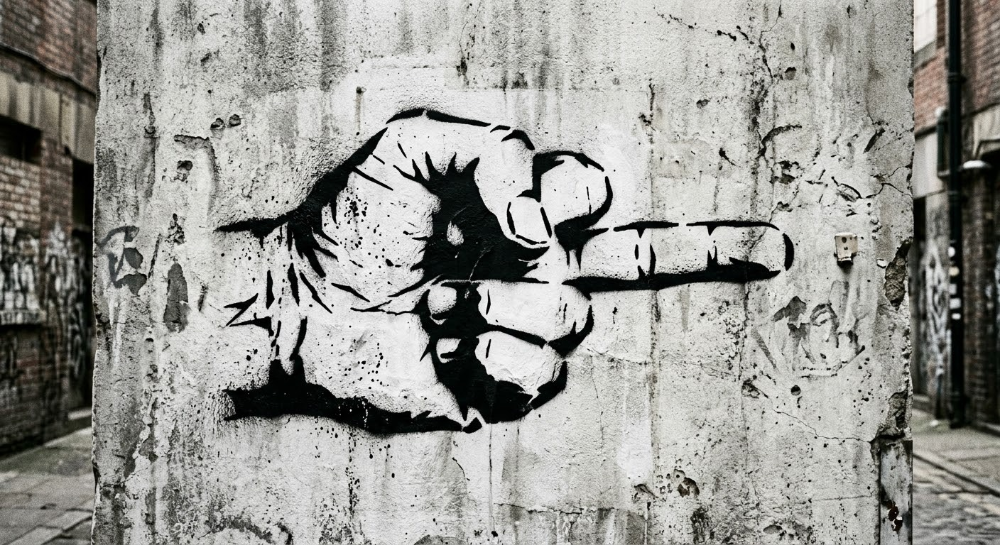

<!DOCTYPE html>
<html lang="ja">
<head>
    <meta charset="UTF-8">
    <meta name="viewport" content="width=device-width, initial-scale=1.0, maximum-scale=1.0, user-scalable=no">
    <title>自転車 右折ウィンカー</title>
    
</head>
<body>

    

        <!-- 1つ目のグループ -->
        

            

                
            

            

                
            

        

        <!-- 継ぎ目をなくすための複製グループ -->
        

            

                
            

            

                
            

        

    

</body>
</html>
            width: 100%;<!DOCTYPE html>
<html lang="ja">
<head>
    <meta charset="UTF-8">
    <meta name="viewport" content="width=device-width, initial-scale=1.0, maximum-scale=1.0, user-scalable=no">
    <title>自転車 右折ウィンカー</title>
    
</head>
<body>

    

        <!-- 1つ目のトラック -->
        

            

                
                ➡
            

            

                
                ➡
            

        

        <!-- ループを途切れさせないための複製トラック -->
        

            

                
                ➡
            

            

                
                ➡
            

        

    

</body>
</html>
            height: 100%;
            background-color: #000000;
            overflow: hidden;
            position: fixed;
        }
        .marquee-container {
            display: flex;
            width: 200%;
            height: 100%;
            position: absolute;
            top: 0;
            left: 0;
            animation: scrollLoop 4s linear infinite;
        }
        .marquee-track {
            display: flex;
            align-items: center;
            justify-content: space-around;
            width: 50%;
            height: 100%;
        }
        .item {
            display: flex;
            align-items: center;
        }
        .item img {
            height: 30vh;
            width: auto;
            object-fit: contain;
        }
        @keyframes scrollLoop {
            0% { transform: translateX(-50%); }
            100% { transform: translateX(0%); }
        }
    </style>
</head>
<body>
    

        

            

                
            

            

                
            

        

        

            

                
            

            

                
            

        

    

</body>
</html>
